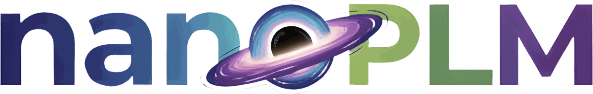

<div align="center">

<picture>
  <source media="(prefers-color-scheme: dark)" srcset=".github/assets/nanoplm-logo-dark.png">
  
</picture>

**F**rom **F**ASTA to **F**oundation model - **F**ast.

[](https://github.com/peymanvahidi/nanoplm/actions/workflows/publish-to-pypi.yml)
[](./LICENSE)
[](https://pypi.org/project/nanoplm/)
[](https://peymanvahidi.github.io/nanoplm/)

<p>🧬 Train your own protein language model, easier and faster. nanoPLM lets you spend less time on engineering and more time on your research questions.</p>

</div>

## 🚀 What makes nanoPLM different?

- **Strong baseline**: a modern architecture and training recipe built with recent LLM techniques. Turn any feature on or off, or tune it, from the YAML.
- **Easy to use**: one YAML file per stage. Get it, edit it, run it. 3 YAML files, 6 commands.
- **Efficient**: custom kernels, FSDP, bf16 and FP8 training get the most out of your GPUs.

---

## 💻 Install

Requires Linux, an NVIDIA Hopper GPU (H100/H200), a CUDA ≥ 13.0 driver and Python 3.12–3.13.

```bash
uv venv && source .venv/bin/activate
uv pip install "nanoplm @ git+https://github.com/peymanvahidi/nanoplm" \
    --extra-index-url https://download.pytorch.org/whl/cu130
nanoplm deps install
```

See the [install guide](https://peymanvahidi.github.io/nanoplm/start/install/) for clusters, contributor setup and troubleshooting.

---

## 🛠️ Zero-to-model in 6 commands

Each stage works the same way: get a YAML file, edit it, run it.

```
nanoplm data get-yaml          # 1. get data.yaml, point it at your FASTA
nanoplm data from-yaml         # 2. tokenize into train/val shards

nanoplm pretrain get-yaml      # 3. get pretrain.yaml, pick your model and features
nanoplm pretrain from-yaml     # 4. train

nanoplm eval get-yaml          # 5. get eval.yaml, point it at a checkpoint
nanoplm eval from-yaml         # 6. benchmark it
```

---

## 📖 Documentation

The full documentation lives at **[peymanvahidi.github.io/nanoplm](https://peymanvahidi.github.io/nanoplm/)**. Good places to start:

- [Your first PLM](https://peymanvahidi.github.io/nanoplm/start/first-plm/): all three stages end to end, from FASTA to benchmark scores.
- [How the pipeline fits together](https://peymanvahidi.github.io/nanoplm/pipeline/): what each stage reads and writes.
- YAML references, with every field documented: [data.yaml](https://peymanvahidi.github.io/nanoplm/reference/data/) - [pretrain.yaml](https://peymanvahidi.github.io/nanoplm/reference/pretrain/) - [eval.yaml](https://peymanvahidi.github.io/nanoplm/reference/eval/)
- [Troubleshooting](https://peymanvahidi.github.io/nanoplm/troubleshooting/): common errors and their fixes.

---

## 🤝 Contributing

PRs welcome. If you’re unsure where to start, open an issue with your use‑case.

---

## ⭐ Like it? Star it.

If nanoPLM saved you time, a star helps others find it and keeps development going.
